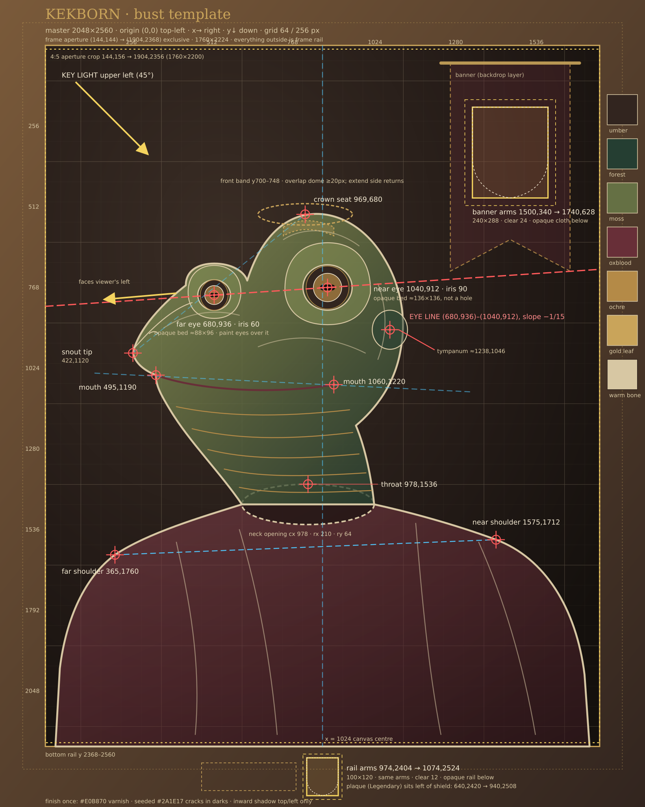

# Kekborn Portrait Style Guide

Kekborn portraits are painted medieval court portraits of **original anthropomorphic frog nobles**, each in a frame.
Every portrait in the collection follows the rules below, whatever its tier, category or traits. The layer library, the
compositor and the sample renders all register to one template:

**[template/bust.svg](template/bust.svg)**: the 2048×2560 master grid with the bust, eye sockets, neck opening,
shoulder slope, frame aperture, labelled alignment marks, the 4:5 crop and the clear space for both shields.
Open it in any browser. The same numbers are in its `<metadata id="kekborn-registration">` block as JSON, so
tools can read them.

[catalog/foundation.json](catalog/foundation.json) records the accepted moss skin and Common wood frame,
their SHA-256 hashes, the registration landmarks and the shared raster finish contract.

---

## 1. Fixed rules (identical on every portrait)

| Rule | Value |
|---|---|
| Subject | Original anthropomorphic frog noble, medieval court dress. **Not** Matt Furie's Pepe or any derivative (see §4). |
| Medium look | Oil painting: visible brushwork, soft light from the **upper left**, warm varnish, fine craquelure |
| Framing | Head and shoulders, **three-quarter view facing the viewer's left**, inside a painted frame |
| Aspect / master | **4:5**, master **2048 × 2560** px, sRGB, 8-bit RGBA layers |
| Palette | Muted earth tones, deep greens, oxblood, ochre, gold leaf (§3) |
| Backdrop | Dark, with a heraldic banner hanging upper right |
| Finish | Varnish, craquelure and frame shadow are applied **once** by the compositor, never painted into layers |

## 2. Master grid and bust template

One grid for everything: origin (0,0) at the **top left**, x to the right, y down, units are master pixels.
Every layer PNG is the full 2048×2560 canvas, transparent outside its paint, so layers stack without offsets.

### 2.1 Frame and crop

| Element | Coordinates | Notes |
|---|---|---|
| Canvas | (0,0) → (2048,2560) | exactly 4:5 |
| Frame aperture | (144,144) → (1904,2368), second corner exclusive | 1760 × 2224. Backgrounds, banners, bust and props paint here |
| Frame rails | everything outside the aperture | left/right/top rail 144 px, bottom rail 192 px (y 2368–2560) |
| 4:5 aperture crop | (144,156) → (1904,2356) | 1760 × 2200. Use for frameless thumbnails. Nothing important may fall outside it |

### 2.2 Landmarks (registered: every skin, eye, expression and attire layer must hit these)

| Landmark | x, y | Notes |
|---|---|---|
| Far eye centre | 680, 936 | iris ≈ 60 px wide; opaque dark eye bed ≈ 88 × 96, within the ≈ 104 × 96 socket envelope |
| Near eye centre | 1040, 912 | iris ≈ 90 px wide; opaque dark eye bed ≈ 136 × 136, within the ≈ 156 × 144 socket envelope |
| **Eye line** | through both eye centres | slope −1/15 (rises toward the near eye); crosses the aperture at (144, 971.7) and (1904, 854.4) |
| Crown seat | 969, 680 | nominal headwear anchor; seat ellipse rx 150, ry 34. Front band overlaps painted skull at y ≈ 700–748; see below |
| Tympanum | 1238, 1046 | moss master's visible ear disc, behind the near eye; approximate ellipse rx 56, ry 62 |
| Snout tip | 422, 1120 | the leftmost point of the head |
| Mouth corners | 495, 1190 (far) · 1060, 1220 (near) | mouth line bows slightly downward between them |
| Throat | 978, 1536 | top of the neck opening, base of the pleats |
| Neck opening | ellipse centre (978,1600), rx 210, ry 64 | collars, sashes and gorgets close over it |
| Shoulder peaks | 365, 1760 (far) · 1575, 1712 (near) | shoulder slope line joins them; the near shoulder is higher and wider |

The registration reference is the accepted **[moss master](layers/skins/moss.png)**, not the schematic head outline.
Both eye beds are **opaque umber paint**, not alpha holes. Their approximate dark cores are ellipses centred at the
fixed eye centres: far rx 44, ry 48; near rx 68, ry 68. Bed edges are irregular brushwork. Paint each complete eye
(iris, pupil and surrounding eye colour) over its bed, feathering under the existing raised lid; do not expect a
background layer to show through. The iris sizes are design targets, not the full eye-layer footprint. Expression
lids and spectacle/monocle rims follow these actual beds while the eye line stays fixed.

The crown seat is an **alignment anchor**, not a guarantee of opaque skin at (969,680). The painted dome begins
near y = 681 at its highest point and drops toward the sides. The front band of headwear must extend below the
seat ellipse into the skull, typically y = 700–748 near the centre, with at least 20 px of painted overlap where
the band meets the dome. Broaden/deepen its side returns to meet the curved skull; inspect over moss at 100% to
avoid a transparent seam or a floating crown. Keep the band above the eye turrets. Do not shift the head or eye
centres to accommodate headwear. Template eye beds, tympanum and crown-overlap guide describe this registration;
the rest of the outline remains a schematic, not a replacement skin silhouette.

### 2.3 Reserved areas and clear space

| Reserve | Box (second corner exclusive) | Clear space | Use |
|---|---|---|---|
| Banner arms | (1500,340) → (1740,628), 240 × 288 | 24 px all round → (1476,316)–(1764,652) | the procedural coat of arms painted on the banner |
| Rail arms | (974,2404) → (1074,2524), 100 × 120 | 12 px all round → (962,2392)–(1086,2536) | the **same** shield, scaled ×5/12, on the bottom rail, centred on x = 1024 |
| Legendary plaque | (640,2420) → (940,2508) | — | engraved name plaque, Legendary frames only |

Both shield boxes are 5:6. The heater-shield outline is the box with a pointed base: straight sides for the top
5/9 of the height, curving to a point at the bottom centre. These are **decoration reserves, not transparent
cutouts**: the banner's opaque cloth and the frame's opaque rail continue underneath both shields and their clear
space. The common frame is opaque in the rail reserve. Arms are painted over these substrates; outside the
heater-shield silhouette the substrate remains visible. No headwear, prop, high-contrast banner fold or frame
ornament may enter either clear-space box. Quiet cloth/wood texture is allowed underneath. The tallest headwear
must stay left of x = 1476 when its top is above y = 652.

## 3. Palette

Mixing anchors (required). Every painted colour is a mix of these, plus the derived values below:

| Name | Hex | Material role |
|---|---|---|
| Umber | `#32251F` | backdrop base, deepest shadows, frame wood shadow, craquelure ink base |
| Forest | `#253E32` | skin shadow side, banner green fields, cloth (vert) |
| Moss | `#657044` | skin mid-tone, common skin base, embroidery thread |
| Oxblood | `#682F38` | court cloth, banner gules, mouth line, lining of robes and hoods |
| Ochre | `#B48A47` | iris base, leather, brass, warm skin edges, parchment shadow |
| Gold leaf | `#C9A45A` | gilding, crowns, chains, frame gold, or-tincture on arms |
| Warm bone | `#D7C7A3` | highlights, throat pleats light side, parchment, linen, pearl |

Derived values (layer painters may use these directly):

| Name | Hex | Role |
|---|---|---|
| Night umber | `#14100D` | aperture edge vignette, pupils' surround |
| Backdrop warm | `#3A2D25` | lit area of backdrop, upper left |
| Lichen light | `#8E9A5C` | skin lit plane, eye turret tops |
| Deep vert | `#17281F` | skin core shadow |
| Pupil black | `#120D0B` | pupils (horizontal bar) |
| Amber iris | `#C08A2E` | iris variant |
| Silver | `#A7A9A4` | silver frame, plate armour lights |
| Silver shadow | `#5E625F` | armour and silver shadow planes |
| Oak | `#6B4A2B` | carved oak frame |
| Plain wood | `#7A5A3A` | common frame |
| Ruby | `#8E1F2B` | gems |
| Sapphire | `#2B4A7A` | gems, azure tincture |
| Emerald | `#2F6B45` | gems |
| Varnish tint | `#E0B870` | compositor varnish (6% multiply, up to 7% in highlights) |
| Craquelure | `#2A1E17` | compositor crack lines |

Never use pure black `#000000`, pure white `#FFFFFF` or saturated primaries. Rare skins (see §5) may push hue
(for example a pale bone-white albino or a deep oxblood-violet morph) but stay in the muted range.

## 4. Original facial anatomy (the Kekborn frog)

The Kekborn frog is its own design. Its parts are:

- **Broad wedge-shaped snout.** From the snout tip (422,1120) the upper snout rises in a nearly straight plane to the
  far eye turret. The front is blunt and wide, like a spade, with a single small nostril slit near (474,1058).
  No rounded "cartoon" muzzle, and no big lips.
- **Asymmetrical eye turrets.** The far turret is small and foreshortened, and it **breaks the silhouette** above
  the snout. The near turret is larger, sits inside the cranium outline and is ringed by a raised lid. Pupils are
  **horizontal bars** in amber/ochre irises: far iris ≈ 60 px, near ≈ 90 px.
- **Visible tympanum** (ear disc) behind the near eye, at about (1238,1046) on the moss master.
- **Low cranial dome** rising to the crown seat at (969,680); the back of the skull curves down into a heavy jowl.
- **Pleated throat.** Five stacked transverse folds run from under the chin down to the neck opening, widening as
  they go down. Light side warm bone, shadow side forest.
- **Mouth line.** A thin oxblood seam from (495,1190) to (1060,1220). Expressions change it only near the corners
  and in the cheek/lid shapes. They never move the corners more than ±24 px.

**Keep it away from Pepe:** no human-like double-lidded bulging eyes side by side on top of the head, no thick red/brown
lips, no "sad frog" droop, no smooth flat cartoon green, no meme poses or hand gestures, and no references to his name or
his catchphrases. If a sketch reads as "Pepe in a costume", redesign the head.

## 5. Painting treatment

| Topic | Rule |
|---|---|
| Light | One key light from the upper left at about 45° (arrow on the template). Lit planes face up-left, cast shadows fall down-right. A weak warm bounce on the shadow-side jaw. No rim lights from behind. |
| Brushwork direction | Strokes follow the form: across the snout plane toward the tip, in arcs that wrap each eye turret, along the pleats on the throat, and diagonally down-right (with gravity) on cloth folds. Backdrop strokes are loose and cross-hatched. |
| Stroke size | Skin 8–20 px strokes at master size; cloth 20–60 px; backdrop 40–120 px. Brush marks stay visible at 50% zoom. |
| Edge softness | Hard edges only at the snout tip, the far turret's silhouette, the iris and pupil, metal highlights and gem facets. Lost-and-found edges where the shadow side of the head meets the backdrop. Soft transitions between skin planes. |
| Skin | Matte with a slight wet sheen on the lit turret tops and snout ridge. Moss mid-tone, lichen light, forest/deep-vert shadow. Fine stippled tubercles on the cranium; smooth, paler pleats. |
| Cloth | Velvet and wool absorb light: broad value steps, soft fold edges, oxblood or forest with darker lining. Linen and parchment in warm bone. Embroidery in moss or gold-leaf thread, painted as broken dabs, not outlines. |
| Metal | Gold, silver and steel have the highest contrast in the image: dark reflected environment, sharp specular dabs facing the upper left, and warm ochre bounce on gold. Gold leaf is painted, never flat yellow. |
| Gems | Deep body colour, one hard facet highlight upper left and a soft glow below. |
| Backdrop | Dark umber with a warmer pool behind the head at upper left; the banner hangs at upper right (shield centred at (1620,484)). |

## 6. Layer stack (bottom to top)

The compositor stacks full-canvas transparent PNGs in this order and then runs the shared finish:

1. **Background**: backdrop paint inside the aperture (5 variants)
2. **Banner**: heraldic banner, with the procedural arms painted into the banner reserve
3. **Props, rear**: lecterns, shelves, candles behind the shoulder line
4. **Attire, back**: cloaks, hoods' back panels, the back of the robe
5. **Skin**: the head and the neck flesh of the frog (6+ skins, incl. 2 rare)
6. **Eyes**: irises and pupils in the sockets (8+)
7. **Expression**: lids, brows, mouth corners, cheek tension (10+: smug, paranoid side-eye, serene, scowl, dim grin…)
8. **Attire, front**: the category garment over the neck opening and shoulders
9. **Face accessories**: spectacles, monocle
10. **Headwear and regalia** for the tier, seated on the crown seat
11. **Props, front**: scroll, orb, gauntlet, tools held at the lower edge
12. **Frame** for the tier, with the rail arms painted into the rail reserve (and the plaque on Legendary)
13. **Shared finish (compositor only, applied once)**: warm varnish (multiply `#E0B870` at 6% opacity plus up to
    1% extra in highlights), fine craquelure (thin seeded `#2A1E17` crack net, more visible in the darks), and the frame's cast
    shadow on the aperture's top and left edges (frame light comes from the upper left, so the shadow falls inside the
    top-left of the opening).

Layers must not bake in varnish, cracks or frame shadow. Otherwise the finish is doubled and samples stop matching.

Raster contract: `finish(image, seedBytes)` is synchronous, mutates and returns the supplied straight-RGBA8 raster,
and leaves every alpha byte unchanged, including partial coverage. Fully transparent pixels retain hidden RGB too.
The finish uses stored sRGB display values without a colour-space conversion. Let `L` be the original paint's
display-space luminance `(0.2126R + 0.7152G + 0.0722B) / 255`. Varnish multiply opacity is `0.06 + 0.01L²`.
Cracks blend toward `#2A1E17` using a seed-derived fine antialiased net (roughly one master pixel wide), with
maximum coverage 24/255, multiplied by `(1−L)²`. This suppresses cracks in highlights and makes the same net
more visible in shadow paint; intersections do not accumulate ink. Very dark paint can pick up a faint warm ink tint.
The shadow is clipped inside the aperture, reaches at most 23% darkening, and fades smoothly over 44 master pixels
from the **top or left** inner edge. It does not add an independent shadow along the right or bottom edge, or on
the frame rails. Aperture/shadow distances scale with preview size. Apply varnish, crack pigment, then shadow;
round RGB only on write. A fixed input, size and nonempty seed gives identical PNG bytes in the same runtime.

## 7. Attire by category

All attire closes over the neck opening and follows the shoulder slope (365,1760)–(1575,1712).

| Category | Garment | Accessory / prop | Notes |
|---|---|---|---|
| **Scholar** | Long oxblood scholar's robe with a high bone-linen collar and a forest hood folded on the back | Round wire **spectacles** (gold-leaf rims) across both eye centres; the bridge sits on the snout ridge between x 760–900 | Lenses: far ellipse ≈ 120 × 110 at (680,936), near ≈ 180 × 160 at (1040,912) |
| **Antiquary** | Umber doublet, ochre waistcoat, bone cravat | **Monocle** on the near eye (ring ≈ 190 px dia. at (1040,912), chain falling to the near shoulder) and a rolled **scroll** held at the lower left with a wax seal | The monocle goes on the near eye only |
| **Knight** | **Plate armour**: gorget over the neck opening, pauldrons on both shoulder peaks, breastplate with central ridge | Optional sword hilt or a tabard with the arms | Silver/steel per §5 *metal*; the near pauldron is larger |
| **Artisan** | **Artisan garb**: undyed wool tunic in moss and ochre, leather apron with straps, rolled sleeves | Tools (chisel, compass, brush) in the apron or held | Fewer lights than nobles; worn edges |
| **Seer** | Deep forest **hood** framing the head (the hood edge passes outside both turrets and leaves the crown seat open) | Glass **orb** held at lower left, with a faint inner glow and a reflected window highlight upper left | The hood's back panel goes in *attire back* and its front edge in *attire front* |
| **Council** | Oxblood court coat with fur trim | **Council sash** from the near shoulder (1575,1712) diagonally across the chest toward the far hip, leaving the bottom of the aperture at about x 500, with a gold badge on the sash at the chest | The sash may carry the tincture of the arms |

## 8. Headwear, regalia and frames by tier

| Tier | Frame | Frame description | Headwear / regalia (on the crown seat) |
|---|---|---|---|
| **Common** | Plain wood | Flat `#7A5A3A` moulding, simple bevel, no ornament; rail arms painted plainly | none or a plain cap |
| **Uncommon** | Carved oak | `#6B4A2B` oak with a carved leaf-and-acorn running band | a felt hat with a brooch or a simple circlet |
| **Rare** | Silver | Silver moulding (`#A7A9A4`/`#5E625F`) with a beaded inner lip | silver circlet or a coronet with points |
| **Epic** | Gilded gold | Gold-leaf moulding with a carved acanthus and a red bole showing through worn gilding | gold coronet, chain of office |
| **Legendary** | Ornate gold with gems and plaque | Deep gold frame with corner cartouches, cabochon ruby/sapphire/emerald gems and an engraved **plaque** at (640,2420)–(940,2508) | jewelled crown, sceptre or mantle clasp |

Headwear uses the crown seat anchor and overlaps the actual skull as described in §2.2, while staying clear of the
banner-arms clear space. Every frame paints the same shield again over the opaque rail in the rail reserve.

## 9. Do / don't

| | Do | Don't |
|---|---|---|
| **Pose** | Three-quarter view, the snout points to the viewer's left, the eyes are on the template eye line, and the near shoulder is higher (1575,1712) | Profile, frontal, or a mirrored pose facing right; a tilted head that moves the eye line; arms raised above the shoulder line |
| **Pose** | Gaze can shift inside the sockets (side-eye) while the head stays registered | Moving the head for an expression: expressions change lids, brows and mouth corners only |
| **Finish** | Clean, unvarnished layers; let the compositor add the varnish, cracks and frame shadow once | Baking yellow varnish or a crack texture into a layer (double finish), or a frame shadow painted into the background |
| **Finish** | Visible oil strokes, broken colour, soft edges on turning forms | Smooth gradients, airbrush, vector flats, photo textures, glossy 3D renders |
| **Silhouette** | Wedge snout, the far turret breaking the outline, a heavy jowl, pleated throat, and sloped shoulders | Round "cartoon" head, two equal eyes on top, thick lips, a human nose or ears: anything that reads as Pepe |
| **Silhouette** | Headwear and props stay inside the aperture and out of both shield clear spaces | A crown poking into the banner arms, a prop crossing the frame rail, or a hood covering the near eye |
| **Registration** | Cover the opaque umber eye beds with eye paint; overlap crown bands into the dome | Treating eye beds as holes, moving the eye line, or floating a crown above the painted skull |
| **Heraldry** | Paint arms onto quiet opaque banner cloth and rail wood; leave those substrates beneath the clear space | Erasing rectangular alpha holes for shields, or putting decorative folds and carving through the arms |
| **Palette** | Mix from the seven anchors; gold is painted gold leaf | Neon green, pure black or white, saturated primary red or blue |
| **Light** | One upper-left key; shadows fall down-right on skin, cloth and props | Lights from below or behind, or conflicting cast shadows between layers |

## 10. Coat of arms (summary for painters)

The arms come from the same seed as the portrait: tincture (field), division, ordinary and charge. They are painted
with the same brushwork and palette (or = gold leaf, argent = warm bone/silver, gules = oxblood, vert = forest,
azure = sapphire, sable = umber). They appear twice with identical design: in the banner reserve (240 × 288) and in
the rail reserve (100 × 120).

## 11. Hand-off checklist for layer painters

- [ ] PNG, 2048 × 2560, RGBA, transparent outside the paint, sRGB, no embedded finish
- [ ] Head layers hit every landmark in §2.2 within ±4 px (eye centres ±2 px)
- [ ] Opaque banner/rail substrate continues beneath shield clear space; only the arms add decoration there
- [ ] Eyes cover the actual opaque beds; crown band overlaps the painted dome without a transparent seam
- [ ] Light from the upper left, palette from §3, visible brushwork
- [ ] Layer checked over [template/bust.svg](template/bust.svg) at 50% opacity
